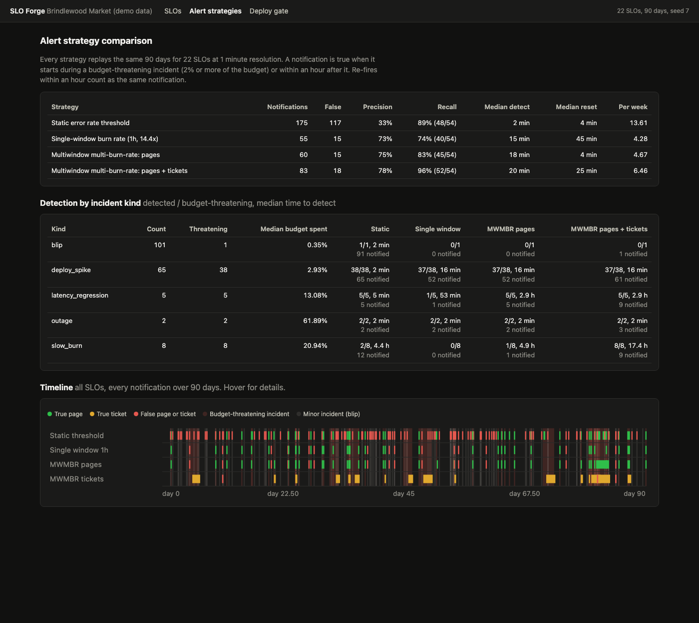
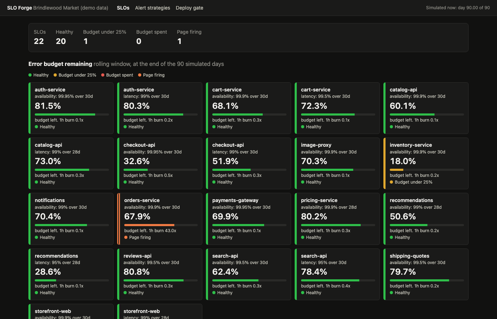
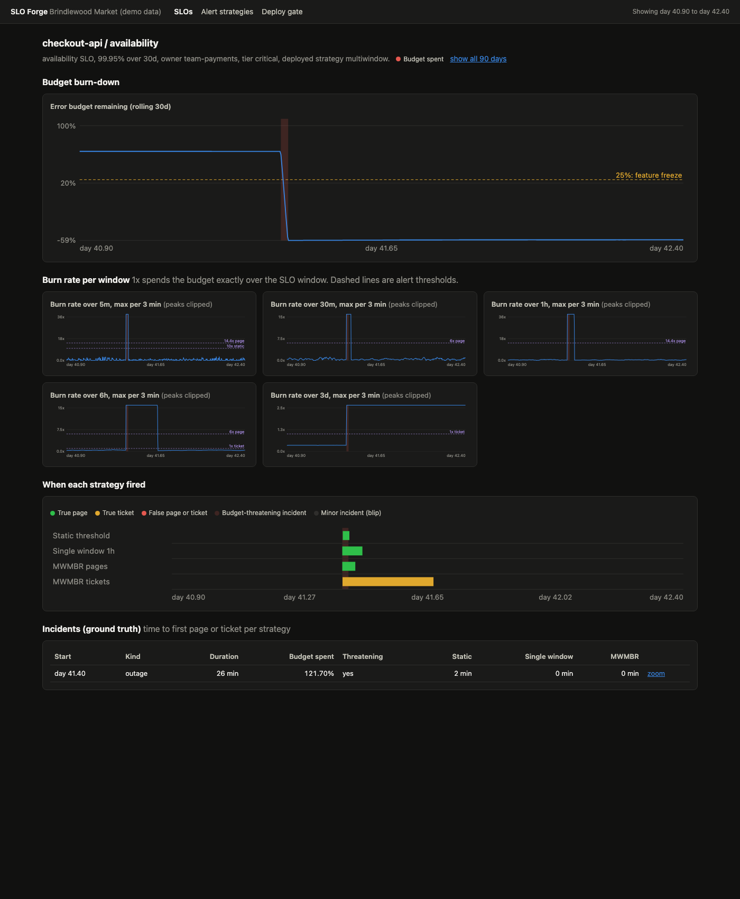
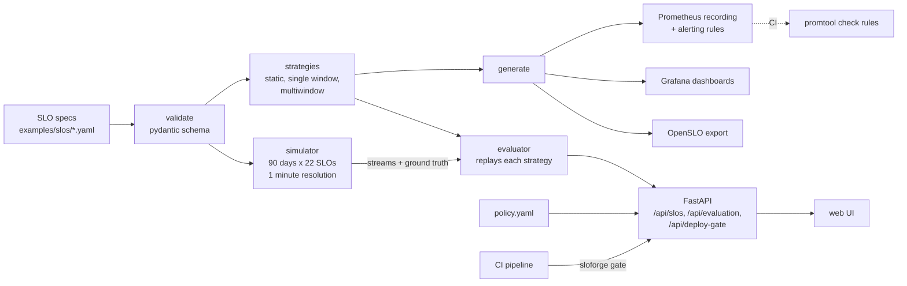

# slo-forge

SLOs as code for Brindlewood Market, a made-up online retailer with 15 services. Each service declares its service level objectives in YAML: the SLI (availability or latency), the objective, a 28 or 30 day rolling window, the owner, and the alerting policy. `sloforge` validates the specs against a schema, generates Prometheus recording and alerting rules for three alert strategies, Grafana dashboards, and an OpenSLO export, then replays 90 simulated days of traffic at 1 minute resolution to measure which strategy pages at the right times. An error budget policy engine answers "can this service deploy right now?" for CI pipelines.



## Results

15 services, 22 SLOs, 90 days, seed 7 (`make evaluate`). 181 planted incidents, 54 of them budget-threatening (they spend 2% or more of the 30 day budget). Every strategy replays the same streams, and the alert conditions are the same objects the rule generator renders to PromQL, so what is scored is what gets deployed.

| Strategy | Notifications | False | Precision | Recall | Median time to detect | Median reset after recovery | Per week |
|---|---|---|---|---|---|---|---|
| Static error rate threshold (5m ratio above 10x budget, for 2m) | 175 | 117 | 33% | 89% (48/54) | 2 min | 4 min | 13.6 |
| Single-window burn rate (14.4x over 1h) | 55 | 15 | 73% | 74% (40/54) | 15 min | 44.5 min | 4.3 |
| Multiwindow multi-burn-rate: pages | 60 | 15 | 75% | 83% (45/54) | 18 min | 4 min | 4.7 |
| Multiwindow multi-burn-rate: pages + tickets | 83 | 18 | 78% | 96% (52/54) | 19.5 min | 25 min | 6.5 |

Detection by incident kind (detected out of budget-threatening, median time to detect):

| Incident kind | Count | Budget-threatening | Median budget spent | Static | Single window | MWMBR pages | MWMBR pages + tickets |
|---|---|---|---|---|---|---|---|
| blip (1 to 4 min) | 101 | 1 | 0.35% | 1/1, plus 90 false pages | 0/1, 0 pages | 0/1, 0 pages | 0/1, 1 ticket |
| deploy_spike | 65 | 38 | 2.93% | 38/38, 2 min | 37/38, 16 min | 37/38, 16 min | 37/38, 16 min |
| latency_regression | 5 | 5 | 13.08% | 5/5, 5 min | 1/5, 53 min | 5/5, 176 min | 5/5, 176 min |
| outage | 2 | 2 | 61.89% | 2/2, 2 min | 2/2, 2 min | 2/2, 2 min | 2/2, 2 min |
| slow_burn (1.5 to 3 days) | 8 | 8 | 20.94% | 2/8, 266 min | 0/8 | 1/8, 293 min | 8/8, 1042 min |

What the numbers show:
- **Static thresholds page on blips and miss slow burns.** 90 of the 117 false pages were blips that spent a median 0.35% of the budget. A slow burn at 2.5x to 5x never pushes the 5 minute ratio over 10x the budget, so 6 of 8 slow burns (median 21% of the budget each) went unnoticed.
- **A single 1 hour window is quiet but slow to reset and blind to slow burns.** It keeps firing for a median 44.5 minutes after recovery because the 1 hour average takes that long to drain, and it missed every slow burn and 4 of 5 latency regressions.
- **Multiwindow multi-burn-rate catches both.** Pages for fast burns (14.4x over 1h and 5m, 6x over 6h and 30m) plus tickets for slow ones (1x over 3d and 6h) find 52 of 54 budget-threatening incidents with 78% precision and under half the notifications of the static rule. The short window resets pages in a median 4 minutes.
- **The cost is time to detect.** Static thresholds see a deploy spike in 2 minutes; burn rate alerts wait until 2% of the budget is gone (16 minutes for a median spike). Slow burns become tickets after a median 17 hours, which is the point: they spend budget over days and do not need anyone woken up.
- **What the false burn-rate pages were.** All 15 were deploy spikes that spent 0.7% to 2.0% of the budget, just under the 2% line used for ground truth. All 15 started between 23:00 and 08:00, the overnight traffic trough, when a given error ratio means fewer failed requests and so less budget.

At day 90 the deploy gate blocks feature deploys for 2 services: `inventory-service` (18% budget left after a 7x slow burn) and `orders-service` (a page is firing during a bad deploy).

SLO overview and the detail page for the checkout outage on day 41 (budget burn-down, then burn rate per window as small multiples, each with its own y-axis and the alert thresholds drawn in):





## Why

Most alerting starts as "page if the error rate is above 1%". It pages at 3 a.m. for a two minute blip that cost nothing, and stays silent while a 0.3% error rate quietly spends a month of budget over four days. The Google SRE workbook (chapter 5, "Alerting on SLOs") walks through the alternatives and lands on multiwindow multi-burn-rate alerts. This project makes that argument with numbers: the same 90 days replayed through each strategy, scored against ground truth. It also covers the parts teams skip: specs in version control with a schema and CI checks, generated rules instead of hand-written PromQL, and an error budget policy that CI enforces instead of a wiki page nobody reads.

## Burn rate math

budget = 1 - objective. For 99.9%, 0.1% of requests may fail.
burn rate = observed error ratio / budget. At 1x the budget lasts exactly the window.
budget spent = burn rate x alert window / SLO window.

| Severity | Long window | Short window | Burn rate | Budget spent before it fires |
|---|---|---|---|---|
| page | 1h | 5m | 14.4x | 2% |
| page | 6h | 30m | 6x | 5% |
| ticket | 3d | 6h | 1x | 10% |

The long window decides whether enough budget is gone to matter. The short window has to agree, so the alert stops firing within minutes of recovery instead of an hour. These are the defaults; each SLO can override them, and `validate` rejects thresholds that can never fire (14.4x on a 90% objective, where 100% errors is only 10x).

## Architecture



- `spec.py`: the YAML format and schema, with errors that name the file and path (`slos[0].objective: Input should be less than 100`).
- `strategies.py`: each strategy as data (windows, thresholds, `for` duration). Both the rule generator and the evaluator read these.
- `rules.py`: recording rules for the SLI error ratio over every window (`sloforge:sli_error:ratio_rate5m` and so on), alert rules per strategy, Grafana JSON, OpenSLO v1.
- `promql.py`: a small PromQL parser for the subset sloforge emits, with type checks (rate needs a range vector) and a rule file checker. CI also runs the real promtool.
- `simulator.py`: diurnal and weekly traffic per service, a baseline error ratio under budget with hourly wobble, and incidents: deploy spikes, blips, slow burns, latency regressions, and two full outages. A 30 day warm-up fills the rolling window first.
- `evaluate.py`: rolling window ratios with prefix sums, Prometheus `for` semantics, episodes, attribution to incidents, and the metrics.
- `budget.py`: the error budget policy and deploy gate.

Scoring rules: an alert episode belongs to an incident on the same SLO if it starts between the incident start and 60 minutes after its end. It is true if that incident is budget-threatening, and false if it matches nothing or a minor incident. A re-fire within 60 minutes of the previous one counts as the same notification (an open incident in the paging tool, grouped by Alertmanager). Reset time is how long the alert keeps firing after the incident ends.

## How to run

```bash
cd slo-forge
uv sync --python 3.12

uv run sloforge validate examples/slos --policy examples/policy.yaml
uv run sloforge validate examples/invalid          # fails on purpose, shows the error format
uv run sloforge generate examples/slos --out out --all-strategies
uv run sloforge check-rules out
uv run sloforge evaluate                            # prints the tables above, about 5 s

uv run sloforge serve --port 8835                   # open http://127.0.0.1:8835
uv run sloforge gate inventory-service --change feature   # exit 1: blocked
curl "http://127.0.0.1:8835/api/deploy-gate?service=cart-service&change=feature"
```

Make targets: `install`, `test`, `lint`, `validate`, `generate`, `promtool` (needs Docker), `evaluate`, `run`, `gate SERVICE=...`, `screenshot`, `docker`.

API:

| Endpoint | What it returns |
|---|---|
| `GET /api/slos?day=` | Every SLO with status, budget remaining, and burn rate per window (5m, 30m, 1h, 6h, 3d) |
| `GET /api/slos/{service}/{slo}?from_day=&to_day=` | Budget series, burn rate per window, thresholds, incidents, and alerts per strategy |
| `GET /api/evaluation` | The strategy comparison and per-kind detection tables |
| `GET /api/timeline` | Every incident and alert episode |
| `GET or POST /api/deploy-gate` | `allowed`, the policies that block, and each SLO's budget |
| `GET /api/rules/{service}?strategy=` | The generated rules for one service |
| `GET /healthz`, `GET /metrics` | Health and Prometheus metrics (requests, gate decisions, budget and burn rate gauges) |

Logs are JSON, one object per line on stderr.

Docker is not needed to run anything locally. The Dockerfile and the promtool check are built and run in GitHub Actions.

## Tests

100 tests, `uv run pytest -q` (about 10 seconds):

- Spec validation: every example loads; out-of-range objective, too many nines, wrong window, missing field, bad service name, unknown field, duplicate SLO, impossible burn rate, short window not shorter, static threshold under the budget, alert window longer than the SLO window, histogram suffix, YAML syntax error with a line number, duplicate service across files, and the exact error paths.
- Burn rate math against the workbook: 14.4x, 6x, and 1x from 2%, 5%, and 10% of the budget; budget spent; 50 hours to exhaustion at 14.4x; 0.864 minutes to detect a full outage on a 1 hour window.
- PromQL: the parser accepts every generated expression and rejects unclosed brackets, rate without a range, compared range vectors, unknown functions, bad regexes, and set operators on scalars. The rule checker catches bad names, record plus alert, bad `for`, and duplicate groups. Every rule generated for the 15 example services passes.
- Generators: recording rules for every window, the workbook multiwindow page and ticket expressions, static `for: 2m`, the deployed strategy from the spec, latency SLIs from histogram buckets, no scientific notation, Grafana and OpenSLO output.
- Simulator: same seed gives identical streams, a different seed differs, the daily cycle, the scripted outage, incidents raise errors without overlapping, the significance flag, baseline inside the budget.
- Strategies on hand-built streams: a quiet stream never alerts; a blip pages only the static rule; a 4x slow burn is missed by static and single window and ticketed after 18 hours as the formula predicts; an 8x burn pages through the 6 hour window after about 4.5 hours; an outage is detected in 0 to 2 minutes, and the reset times differ (single window about 1 hour, multiwindow under 30 minutes).
- Accounting: precision, recall, false pages split into minor incidents and noise, detection and reset per incident, pages per week, Prometheus `for` semantics, episode merging.
- Budget policy and deploy gate: thresholds, change types, active pages, tier-scoped rules, policy validation.
- API end to end: health, metrics, SLO list now and in the past, detail, evaluation tradeoffs, timeline, the gate (GET and POST, blocked and allowed, 404 and 422), rules, the UI, JSON logs. CLI: validate, generate, check-rules, schema, gate.

CI (`.github/workflows/ci.yml`): ruff and pytest; a job that validates the example specs, requires the broken ones to fail, generates everything, and checks it; a promtool job (`docker run --rm --entrypoint promtool -v $PWD/out:/out prom/prometheus check rules /out/*.yaml`); and a Docker job that builds the image, checks `/healthz` and `/metrics`, and runs `sloforge gate` against the container, expecting one allowed and one blocked deploy.

## Production notes

- **Rule cost:** the 3 day and 30 day windows over raw counters are expensive at scale. Record a 5 minute ratio once and derive longer windows with `avg_over_time` over the recorded series, or use Sloth or Pyrra, which generate the same structure.
- **Ground truth:** here incidents are planted. In production, label past incidents from postmortems and replay the real metrics through candidate rules before changing them, as this evaluator does.
- **Low traffic:** burn rates are noisy on services with a few requests a minute. Add a minimum request count to each condition, or alert on synthetic probes for those services.
- **Routing:** send page severity to the on-call rotation and ticket severity to the team queue through Alertmanager, with inhibition so a firing page suppresses the matching ticket.
- **Deploy gate:** read budget from Prometheus (`sloforge:error_budget:remaining`) instead of the simulator, cache it, and fail open with a warning if the gate is down so it never blocks a rollback.
- **Spec ownership:** keep specs next to each service's code with CODEOWNERS, and run `validate` and `generate` in every service repo's CI, publishing rules to a central Prometheus through a GitOps sync.

## License

MIT. See [LICENSE](LICENSE).
